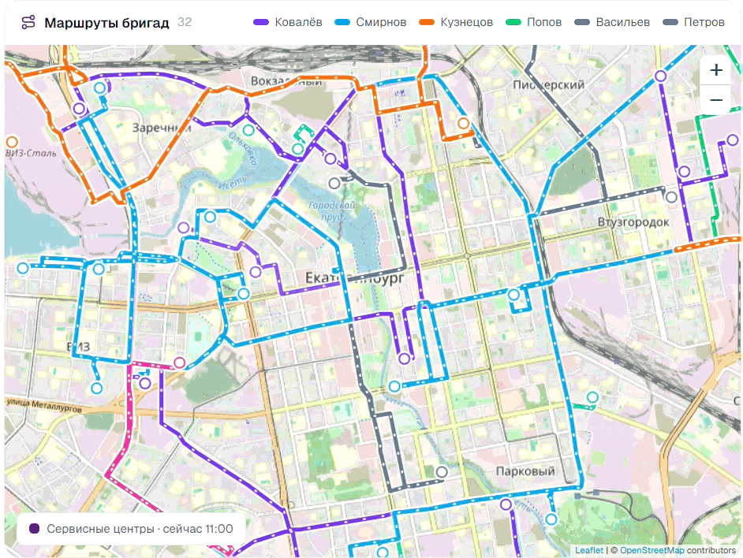
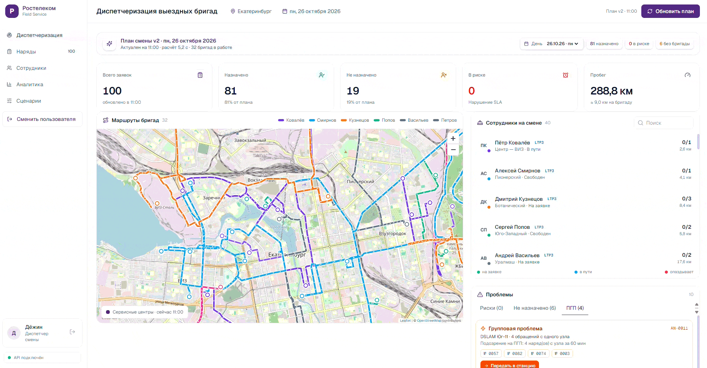
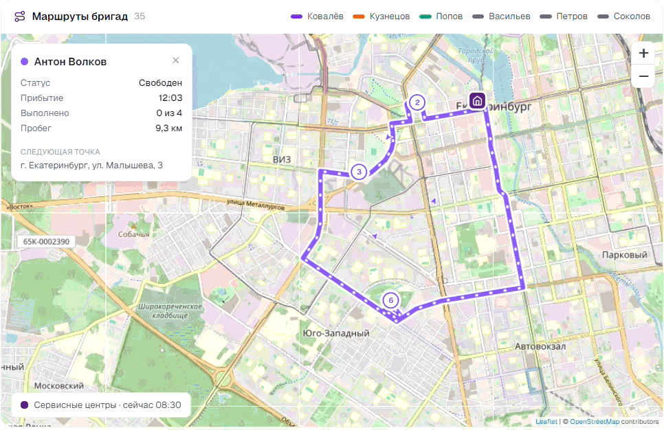
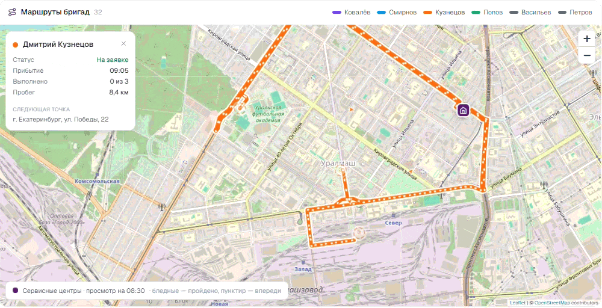
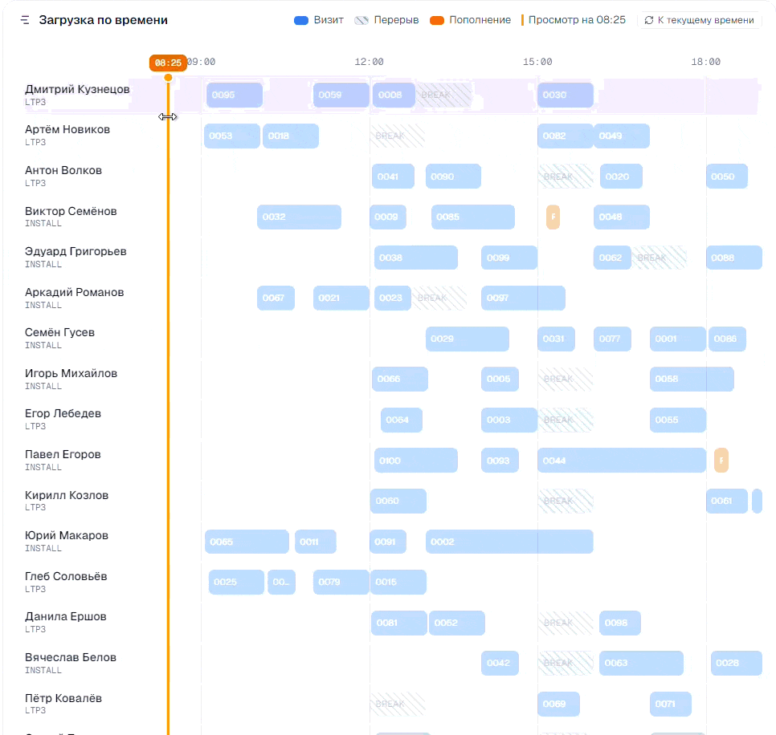
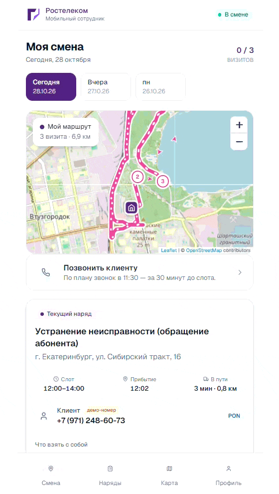

# Сервис планирования выездных работ (VRPTW)

Прототип разработан в рамках Всероссийского хакатона связи по кейсу компании **«Ростелеком»** (занял **2-е место по экспертной оценке** среди команд трека).

Система автоматизирует распределение нарядов между выездными бригадами с учётом временных окон, квалификации сотрудников и запаса оборудования, а также включает [модуль](docs/scenario-analysis.md) сценарного анализа («what-if» моделирование) и мобильный кабинет инженера.

**Стек:** Java 21 · Spring Boot · Timefold Solver · PostgreSQL · Docker Compose · Angular  



<details>
<summary>Презентация(3 сек. на слайд)</summary>


<details>
<summary>Дополнительные демонстрации интерфейса</summary>

- **Полноэкранная карта и обзор маршрутов:**
  
  
- **Таймлайн загрузки бригад (диаграмма Ганта и курсор времени):**
  
  
- **Мобильный кабинет выездного сотрудника:**
  
</details>
</details>

## Установка и запуск
**Требования:** Docker 24+ и Docker Compose v2 (для контейнеров) либо JDK 21 и Node.js 20.19+ / npm 10+ (для локального запуска).


### Запуск в Docker

```bash
git clone https://github.com/kuriganovvv/vrptw.git
cd vrptw
docker compose up --build -d
```

Проверка статуса:

```bash
docker compose ps
curl http://localhost:8080/api/v1/health
```

- Веб-интерфейс диспетчера: <http://localhost>
- REST API: <http://localhost:8080/api/v1>
- Остановка: `docker compose down`

## Локальный запуск

```bash
# 1. Поднять только PostgreSQL
docker compose up -d postgres

# 2. Запустить Backend (http://localhost:8080)
cd backend && ./gradlew bootRun          # Windows: gradlew.bat bootRun

# 3. Запустить Frontend в отдельном терминале (http://localhost:4200)
cd frontend && npm ci && npm start
```

> Для отладки без PostgreSQL можно переключить хранилище в память: `VRPTW_STORAGE_MODE=memory ./gradlew bootRun`.

## 2. Функциональность и разделы UI

* **Кабинет диспетчера:**
  * `/dashboard` — интерактивная карта маршрутов и сводка;
  * `/orders` — список и статусы нарядов дня;
  * `/staff` — бригады, смены и квалификации;
  * `/analytics` — метрики выполнения и пробега;
  * `/scenarios` — сценарный анализ («что если на смену выйдет меньше сотрудников» и «какой запас оборудования нужен без заезда в СЦ»).
* **Мобильный кабинет сотрудника (`/login` по `staff_id` `ST-001…ST-040`):**
  * `/app/shift`, `/app/orders`, `/app/map`, `/app/profile` — маршрут, наряды, карта и профиль строго выбранного сотрудника (работает в режиме чтения по `GET /api/v1/ui/*` и `GET /api/v1/days/{date}/plan`).


### Пример запроса сценарного анализа

```bash
curl -s -X POST http://localhost:8080/api/v1/days/2026-10-26/scenarios \
  -H 'Content-Type: application/json' \
  -d '{"staff_delta": -3, "time_limit_sec": 5}'
```

## Backend и PostgreSQL

Состояние сервиса (справочники, матрица времени в пути, наряды, версии планов и события дня) хранится в **PostgreSQL**. Схема создаётся автоматически при старте из `backend/src/main/resources/schema.sql`, а начальные данные загружаются из `data/` (`reference.json`, `travel_matrix.json`, `day_*.json`).

* Если файл в `data/` обновился (например, после `git pull`), автозагрузка обновит запись и сбросит старый план на эту дату, не затрагивая данные, загруженные через API.
* Переменные окружения:
  * `SPRING_DATASOURCE_URL`, `SPRING_DATASOURCE_USERNAME`, `SPRING_DATASOURCE_PASSWORD` — параметры БД (по умолчанию `jdbc:postgresql://localhost:5432/vrptw`, `vrptw`/`vrptw`);
  * `VRPTW_DATA_DIR` — путь к каталогу с данными;
  * `VRPTW_SEED_ENABLED=false` — отключить автозагрузку из `data/`;
  * `VRPTW_SEED_FORCE=true` — принудительно перечитать все файлы при старте.


## 4. Тесты и сборка

```bash
cd backend && ./gradlew test
cd frontend && npm run build
cd frontend && npm test -- --watch=false
```